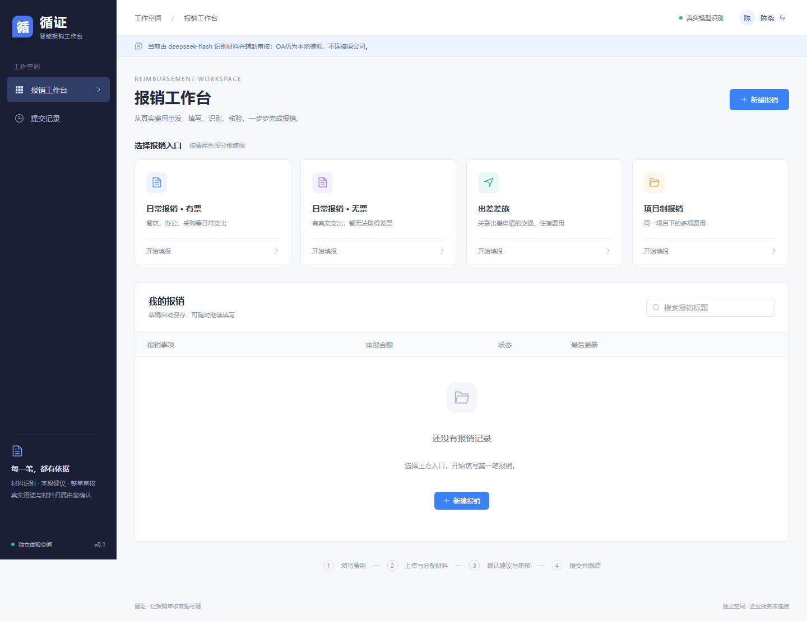
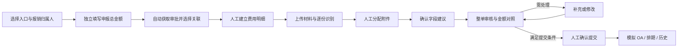
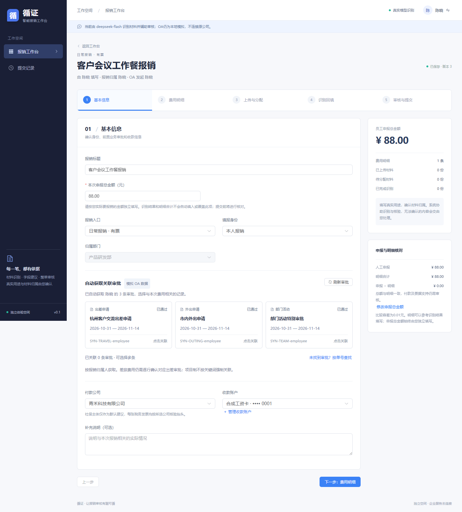
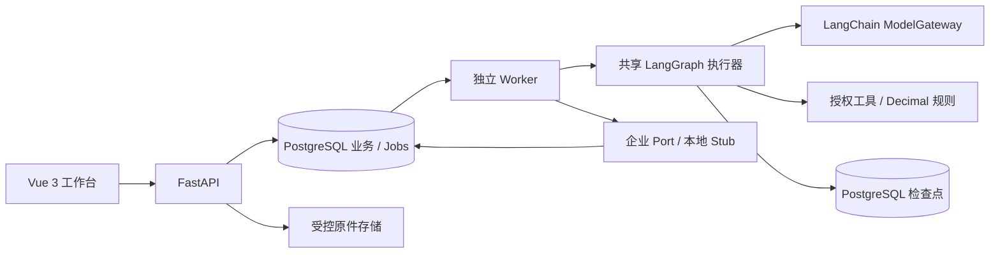

# 循证 · Expense Audit Agent

基于真实企业报销场景构建的 **OA 前置智能报销审核系统**。员工独立申报金额、建立费用明细并分配材料，系统使用多模态模型理解票据与支付凭证，通过有界 Agent、确定性规则和人工确认完成提交前审核。

**Vue 3 · TypeScript · FastAPI · PostgreSQL · LangChain · LangGraph**

这个项目呈现一套可以实际操作的报销产品：引导填报、材料工作台、字段建议、审核、排期、提交历史、管理案件、台账和反馈均有实现。企业接口使用本地模拟适配器，模型支持真实服务；不需要原公司的账户与业务数据即可运行。



## 业务价值

真实报销材料包括发票、付款截图、退款记录、铁路票、聊天转账和行程佐证。材料识别、金额含义、凭证归属和业务规则需要一起判断，只有一个金额识别接口并不足以完成审核。

系统将员工申报、模型事实和程序规则分开：

- **员工声明**：实际用途、项目、费用结构、材料归属及本次申报总金额。
- **Agent 能力**：逐份理解材料，复用结构化事实，补看证据并提出受控的人工问题。
- **程序约束**：精确金额计算、权限、退款计入、逐张抬头、关联审批、版本有效性与最终提交。

## 完整业务流程



### 关键业务设计

**独立申报总金额**在基本信息中固定展示。识别、回填、导入和明细汇总不会自动填写或覆盖它。审核同时展示人工总额、明细合计和差额；差额超过 0.01 元会阻止提交，修改后旧报告失效。普通少报、付款支持和发票支持分别核验。

**关联审批自动获取**：进入草稿或切换归属人时，自动读取该归属人的审批，卡片展示类型、日期、状态和单号，员工直接选择；单号查找仅作补充。差旅仍需逐行确定对应出差审批，不自动套用第一条。



桌面与手机使用相同业务流程：[查看手机页面](docs/images/mobile.png)。

## 功能范围

| 模块 | 已实现能力 |
| --- | --- |
| 业务入口 | 日常有票、日常无票、差旅、项目、授权供应链 |
| 身份 | 本人、普通代报、管理员协助代发；操作人/归属人/OA 发起人分开 |
| 材料 | 图片/PDF、分页预览、批量上传、人工归行、改名/移除、去重、Excel 嵌图导入 |
| Agent | 逐份识别、字段建议、整单审核；有类型输出、工具白名单、预算、检查点、人工等待 |
| 审核 | 独立总额、有效付款/税票、退款与未付款、逐张抬头、逐行差旅日期、旧结果失效 |
| 提交 | 最终复核、幂等模拟创建、月度排期、节流、unknown 查询、撤销复制 |
| 管理 | 案件、受控修复/代发、任务池、审计事件、本地台账 audit/sync/受限回滚 |
| 反馈 | 合成人员邀请、随机专属链接、短问卷、去重和 CSV 导出 |

## 快速运行

### Windows 原生运行

需要 Git、Node 24、uv 和 PowerShell 7。Python 3.13 与锁依赖由 uv 管理，首次运行需联网。

```powershell
git clone https://github.com/coldwind-fss/expense-audit-agent.git
cd expense-audit-agent
./infra/start-local.ps1 -InstallPostgres
./infra/start-static.ps1
```

打开 **http://127.0.0.1:18880/**。默认使用 fixture 合成材料，无需 Key；在材料步骤选择“选择合成样本”即可体验。API 文档在 http://127.0.0.1:18881/docs，开发页面在 http://127.0.0.1:5173/。

```powershell
./infra/stop-local.ps1
```

停止脚本仅处理本项目记录的应用进程，保留 PostgreSQL 和数据。后续启动可省略 `-InstallPostgres`。详细环境、独立测试库及容器方式见[运行指南](docs/RUNNING.md)。

### 真实多模态模型

复制 `backend/.env.example` 到 `backend/.env`，只在本机设置：

```dotenv
MODEL_MODE=provider
MODEL_PROVIDER=deepseek
MODEL_NAME=deepseek-flash
MODEL_BASE_URL=https://api.deepseek.com
MODEL_API_KEY=在本机填写
```

重启 API/Worker 后生效。Key 不进入前端、日志或版本库。fixture 仅识别登记的合成原件；任意新图片必须使用真实模型。不同模式的事实不能冒充或混用。

## 架构



三个任务共用执行基础，并非每个步骤都重复调用模型：材料识别使用多模态，字段建议复用可信事实和确定计算，整单审核先执行必检工具，再处理证据和不确定项。详情见[Agent 技术设计](docs/AGENT_TECHNICAL_DESIGN.md)。

## 阅读项目

| 想了解什么 | 文档 |
| --- | --- |
| 产品目的、用户、功能与交互 | [产品基线](docs/PRODUCT_BASELINE.md) |
| 金额、票据、身份、审批与日期规则 | [业务基线](docs/BUSINESS_BASELINE.md)、[业务场景](docs/BUSINESS_SCENARIOS.md) |
| 三个任务与人工介入 | [Agent 产品行为](docs/AGENT_PRODUCT_BEHAVIOR.md) |
| 前后端、数据、队列与部署架构 | [技术基线](docs/TECHNICAL_BASELINE.md) |
| 图、工具、循环、上下文与恢复 | [Agent 技术设计](docs/AGENT_TECHNICAL_DESIGN.md) |
| HTTP、并发、幂等与接口入口 | [API 约定](docs/API_CONVENTIONS.md)、[OpenAPI](backend/openapi.json) |
| 如何组织实现 | [实施结构与工作包](docs/IMPLEMENTATION_PLAN.md) |
| 安装、运行、模型配置 | [运行指南](docs/RUNNING.md) |
| 测试和真实模型验证 | [测试说明](docs/TESTING.md)、[模型评估](docs/MODEL_EVALUATION.md) |
| 代码从哪里看起 | [源码导读](docs/CODE_GUIDE.md) |

## 验证与边界

本机验证包括 PostgreSQL 迁移/检查点、后端 **40 项**回归、前端 **3 项**单测、**11 项**浏览器流程，以及真实模型关键流程。具体层级和适用版本见测试及模型评估文档；GitHub Actions 执行离线工程检查，不隐式调用付费模型。

OA、目录、通知和财务台账使用本地合成数据及 Stub。`SIM-…` 代表模拟创建，不表示真实审批通过、财务入账或付款。合成模型评估不等于所有真实票据的识别准确率。Docker 配置已提供，本机验收环境未安装 Docker，因此不宣称容器运行已验证。
