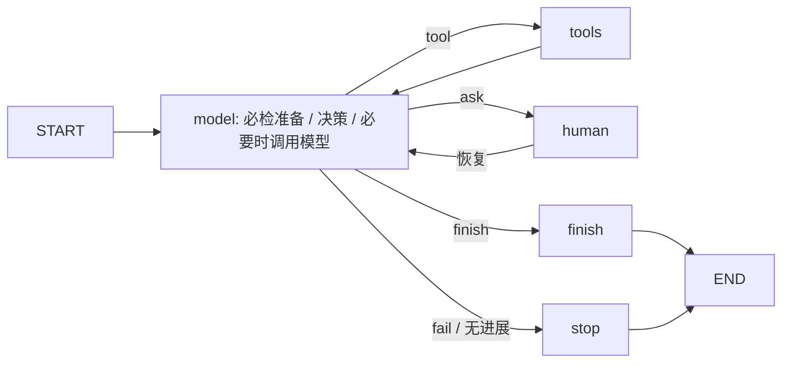

# Agent 技术设计

## 1. 编排形态

一个共享StateGraph承担material_extract、line_suggest、claim_review。任务注册表固定输入、提示、工具白名单和预算，ModelGateway隔离fixture/provider。业务应用服务负责快照、状态和事务发布。

以上节点与`agent_graph.py`中的model、tools、human、finish、stop对应。provider的必要准备在model节点内优先转为工具动作：材料识别必须先读全部授权页，审核必须读取缓存事实并执行规则工具。模型不能跳过这些步骤直接给出通过结果。

## 2. Handler 与预算

| task_kind | 工具白名单 | 模型调用上限 | 工具上限 | 超时 |
| --- | --- | --- | --- | --- |
| material_extract | read_material_pages | 4 | 8 | 180秒 |
| line_suggest | read_cached_facts、calculate_supported_amounts | 2 | 4 | 60秒 |
| claim_review | read_cached_facts、read_material_pages、run_rule_checks | 6 | 12 | 180秒 |

另有有界轮数和连续无进展停止。计数持久化，恢复/重试不能无限刷新预算。上限不表示每次都调用这些次数，正常回填可为0次模型调用。

## 3. 状态与结构化动作

State保留不可变snapshot、task_kind、mode、action、observations、rounds、no_progress、review、response、output和stop_reason。

Pydantic Action只有tool、finish、ask、fail四种动作；工具名和参数另经白名单/schema校验。Facts明确材料角色、金额、付款状态、退款关联与完成状态、交易ID、日期类型、票号、购销方、净额/税额和候选。金额必须为合法十进制字符串，日期须可解析。

真实模型通过LangChain ChatDeepSeek或兼容ChatOpenAI返回JSON，再经Pydantic和图约束验证；不是用一段自由文本直接决定数据库写入。

## 4. 工具与证据

- `read_material_pages`：仅能读取当前快照授权的原件/页。page=0表示全部页，返回受控引用；出站调用前才装载图像。
- `read_cached_facts`：当前任务的事实，不跨workspace或任意读取全库。
- `calculate_supported_amounts`：确定性有效付款/票据计算。
- `run_rule_checks`：程序执行金额、主体、公司、审批、日期和必要状态，输出RuleCheck集合。

原价、优惠、退款和重复由结构化事实参与确定计算。模型可以解释材料和请求补证，不能改变Decimal容差、角色权限、独立人工总额或最终提交条件。

## 5. 三任务结果发布

材料任务生成版本化MaterialFact，并按角色和交易/票号判断计入与疑似重复。更新事实及明细同步时不改变人工总额，也不静默覆盖人工/导入行金额。

建议任务读取归属事实，由服务生成版本化批次items，保存前值、字段来源、证据和保护状态。采纳/撤回是应用事务，不是模型自由调用的写工具。

审核任务必须持有程序检查结果才可完成；报告关联input_revision、input_signature、execution_mode。最终提交重新检查当前签名及确定规则，即使模型错误声称通过也不能绕过。

## 6. 人工中断与恢复

human节点调用LangGraph interrupt，检查点写入PostgreSQL。纯阅读补充在同run/thread以Command(resume=...)恢复；人工付款确认等业务变更先保存领域决定、提升申报修订，再创建新任务，旧任务标记outdated。

问题ID、材料范围和可接受字段均由服务校验。重复响应走命令幂等；不把任意客户端JSON直接传给图作为业务修改。

## 7. 上下文、租约与幂等

输入快照只含本任务需要的当前业务/事实和授权页引用。provider快照不含fixture答案，检查点不保存图像base64或Key。thread_id由run与attempt组成，新的执行尝试不复用旧线程。

Worker在PG认领任务，45秒租约并持续续租。节点记账及发布均检查lease_token、run状态和attempt；版本改变、取消或租约被替代后拒绝写入。业务幂等与图检查点分别处理，checkpoint不充当外部事务保证。

## 8. 失败与可观测性

超时、限流、结构错误、空结果、页/图像预算不足、工具越权、无进展和取消都有明确终态。SDK自动重试关闭，真实失败不会隐式返回fixture结果。

记录任务/工具/耗时/计数、prompt/schema/model/graph与规则版本和stop_reason。只显示可验证依据与检查，不记录或展示隐藏推理，不把敏感原件正文写入普通日志。

## 9. 版本与测试入口

- 图/提示profile：reimbursement.v2.1；材料schema：material.v1；当前规则：reimbursement-v1-002。
- `test_workflows.py`覆盖人工等待、建议保护、业务变更重检。
- `test_boundaries.py`覆盖预算/无进展、lease更替、旧结果拒绝、金额和独立总额。
- `test_foundation.py`包含断开重连及跨进程检查点恢复。
- `test_provider.py`覆盖真实适配契约的超时/限流/结构失败与图片授权。

实际模型效果单列于[模型评估](MODEL_EVALUATION.md)，不以fixture图测试代替。
