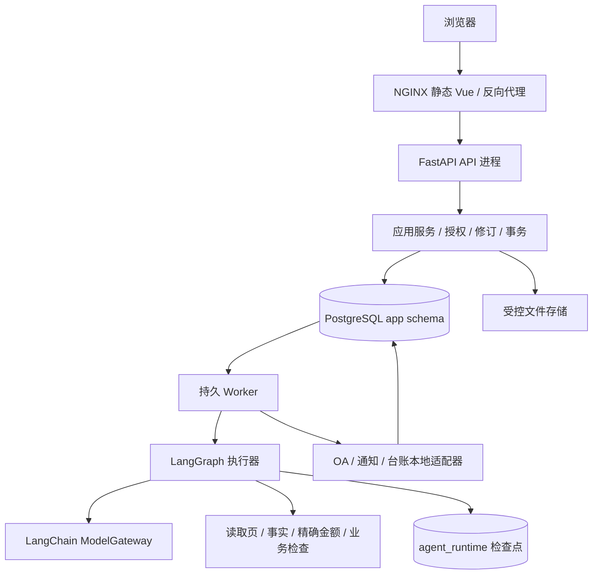
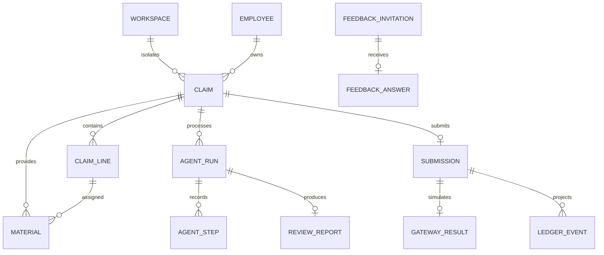

# 技术基线与架构

> 应用：0.1.0；数据库：0004；规则：reimbursement-v1-002；Agent 图/提示 profile：reimbursement.v2.1。

## 1. 技术选择

| 层 | 技术 | 作用 |
| --- | --- | --- |
| 前端 | Vue 3、TypeScript、Vite、Router、Pinia、Element Plus | 引导编辑、材料、审核、历史与管理 |
| 数值 | decimal.js / Python Decimal / PostgreSQL NUMERIC | 金额保持十进制字符串和0.01容差 |
| API | Python 3.13、FastAPI、Pydantic | 类型、鉴权、应用服务与标准错误 |
| 数据 | SQLAlchemy、psycopg、Alembic、PostgreSQL18 | 业务事务、复合约束、持久任务 |
| Agent | LangChain、LangGraph、AsyncPostgresSaver | 模型适配、有界状态图、持久中断与恢复 |
| 文件 | Pillow、pypdfium2、openpyxl | 图片规范化、PDF页、Excel嵌图 |
| 运行 | 独立 API/Worker、NGINX、uv/npm 锁文件、Compose | 服务分工、构建与启动 |
| 检查 | pytest/HTTPX、Ruff/mypy、Vitest、Playwright | 规则、PG/API、契约、图与浏览器 |

精确依赖以`backend/uv.lock`和`frontend/package-lock.json`为准。无Redis、向量库、RAG或微服务集群前置依赖。

## 2. 实际部署结构

API接受命令和返回资源；Worker处理文件准备、导入、Agent、模拟提交与旁路。二者共享同一Python领域代码和数据库，不通过内部HTTP绕一圈。前端不直连模型或数据库。

## 3. 源码模块

| 位置 | 实现职责 |
| --- | --- |
| `frontend/src/pages/ClaimEditor.vue` | 五步编辑、自动保存、独立总额、主体、账户、审批及导入 |
| `components/ApprovalPicker.vue` | 审批自动获取结果、关联卡片和单号补查 |
| `components/MaterialWorkbench.vue` | 材料上传/预览/分配/更正 |
| `components/AgentPanel.vue` | 建任务、建议确认、问题响应、报告与提交 |
| `api/client.ts` / `api/generated.ts` | Cookie/CSRF/错误/命令键、金额与生成契约 |
| `api_claims.py` | 身份目录、审批查询、草稿、明细与账户 |
| `api_materials.py` / `preparation.py` / `imports.py` | 原件入口、持久准备、PDF/图像和Excel |
| `api_agents.py` / `agent_service.py` | 三任务、快照、发布、人工响应与建议事务 |
| `agent_graph.py` / `task_handlers.py` / `model_gateway.py` | 状态图、白名单/预算、模型与结构化动作 |
| `rules.py` | 材料计入、金额/抬头/审批/日期确定检查 |
| `submission_service.py` / `api_submissions.py` | 冻结提交、排期、幂等、unknown及撤销复制 |
| `api_operations.py` / `ledger.py` | 管理案件、任务、台账、反馈与受控模拟事件 |
| `models.py` / `db.py` / `services.py` | 关系模型、连接、序列化、修订、审计与命令幂等 |
| `worker.py` | PG认领、租约、心跳、并发处理和恢复 |
| `security.py` / `ports.py` / `observability.py` | 会话与权限、外部边界、结构化日志 |

模块在单一Python包内按行为分工，没有为每个表复制一套薄服务。

## 4. 数据所有权

业务真相位于`app` schema，图检查点位于`agent_runtime`。主要关系为workspace→员工/公司/账户/报销；报销→明细/材料/修订/任务/报告/提交；提交→模拟结果/台账事件；邀请→答卷。

关键父子关系含workspace复合唯一键和外键。单报销提交唯一、命令键唯一、邀请收件人和答卷唯一等约束保证事务内的去重。候选、问题、输出、事件细节和批次字段等小对象使用有版本JSONB。

原件及衍生页以受控存储键保存，读取接口先做授权；不把文件目录映射为网站静态路径。账户以Fernet加密，前端只取得掩码。

## 5. 修订、快照与人工总额

修改命令携带expected_revision，服务端锁定/核对后更新。冲突返回409，前端保留输入并允许明确重试，不静默覆盖。

申报总额是人工字段，初始空且不随明细计算。API仅接受total_auto=false，字段保留历史兼容；审核要求独立正数和明细匹配。材料发布和批量回填只能改变对应事实/明细；它们引起修订增加及报告失效。

Agent输入保存不可变快照，签名包含修订、事实版本、规则/模型/图模式。最终提交还重新运行当前规则，不能仅持有曾经通过的报告。

## 6. 任务、租约和恢复

jobs表统一承载prepare/import/agent/dispatch/ledger，Worker以`FOR UPDATE SKIP LOCKED`认领，使用45秒租约及续租。执行结果发布时校验lease_token、attempt和输入版本；旧Worker即使完成也不能覆盖当前状态。

Agent重试使用新的attempt/thread，计数不能因重试无限重置。检查点用于图恢复，不代替业务幂等。业务发布按事务收敛，完成后检查点保存失败也不能重复写入结果。

发送类任务与Agent恢复分开：发送中断后结果可能unknown，先查询已有模拟实例，不按Agent自动重跑逻辑重建；旁路台账失败用独立任务恢复。

## 7. 外部适配与模式

企业提交、目录、通知和台账有清楚的端口/本地适配边界。模拟结果包含adapter_mode=stub、SIM引用和空的真实external_instance_id，不冒充原企业接口已接通。

模型fixture/disabled/provider进入事实来源与缓存签名。真实模式使用服务端配置的LangChain provider；SDK自动重试关闭，失败不降级为fixture。当前真实接入为DeepSeek官方多模态服务，也有通用OpenAI兼容适配入口。

## 8. 安全与工程边界

体验workspace与服务端登记persona组成可操作合成空间，不是生产SSO。Cookie为HttpOnly，修改请求检查CSRF与Origin，所有资源与工具再次检查workspace/主体/角色。模型不能执行任意SQL、Shell、自由URL或最终提交命令。

普通日志仅记录请求/任务/状态/耗时等允许字段，不保存Key、token、账户全文、票据正文或模型隐藏推理。默认测试强制fixture与空模型Key。

迁移为0001—0004，0002固定DDL、0003复合范围约束、0004独立总额兼容处理。已提交快照不回写，常规迁移不使用破坏性downgrade或删库重建。

## 9. 构建与运行

Windows原生脚本管理独立PG/API/Worker/Vite/NGINX，运行状态在忽略的data目录，遇到其他进程或其他工作区链接会拒绝覆盖。Compose提供PG、一次性迁移、API、Worker和Web；镜像不复制本地.env或依赖目录。

OpenAPI由后端生成，TypeScript据此生成；CI检查重新生成后没有未提交契约差异。部署、真实模型、容器运行与规则测试分别报告，不混算。
